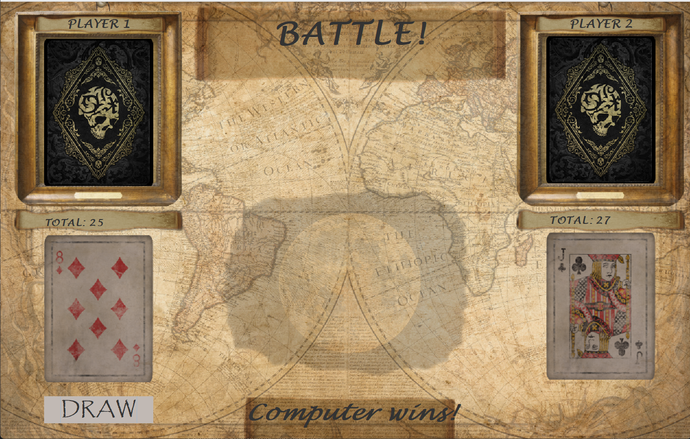

# War Card Game

A desktop implementation of the classic card game **War**, built in Java with a Swing GUI.

## Features

- Full graphical interface (JFrame/JPanel) with card art, table background, and background music
- Single-player mode (vs. a computer opponent), two-player mode, and a guest mode
- Classic "War" tie-breaking rule: when both players draw equal-rank cards, each draws
  three more cards face-down and a fourth face-up, repeating recursively until the tie
  is broken, with the winner taking the whole pile
- Save/resume games and save user accounts to disk (flat-file persistence)

## Design

- `deck` — `Card`, `CardCatalog`, `ShufflingDeck`: card model and deck shuffling/dealing
- `player` — `User`, `HumanPlayer`, `ComputerPlayer`, `GuestPlayer`: OOP class hierarchy
  (inheritance/polymorphism) for the different player types
- `game` — `Game`, `GameState`, `GamesList`: game loop, round/war resolution, saved-game state
- `file` — `SaveUsers`, `ReadUsers`, `SaveGame`, `ReadGames`: text-file persistence
- `Gui` — `FirstMenu`, `MainMenu`, `SignedInMenu`, `CardGame`, `GuestGame`, `SoundPlayer`: Swing UI
- `main` — application entry point

## Running

Open the project in an IDE that supports Eclipse/IntelliJ-style projects, compile the
`src/` sources, and run `main.Main`. Card art and audio are loaded from `resources/`.
